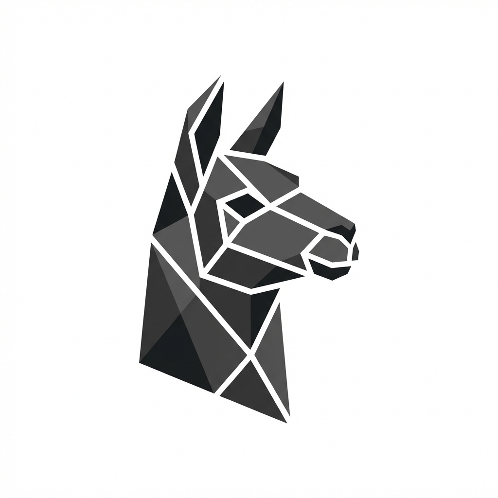
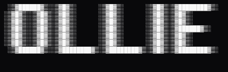
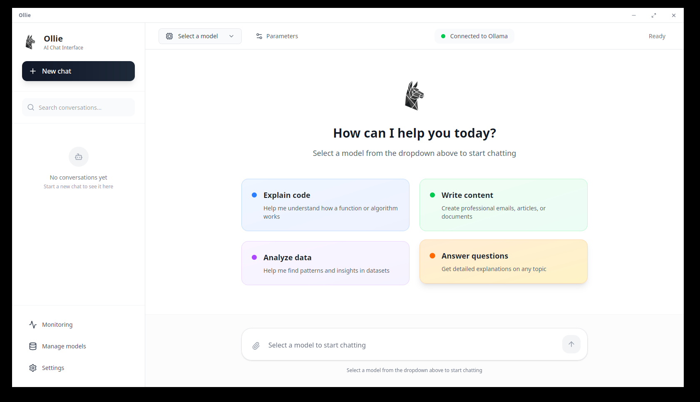
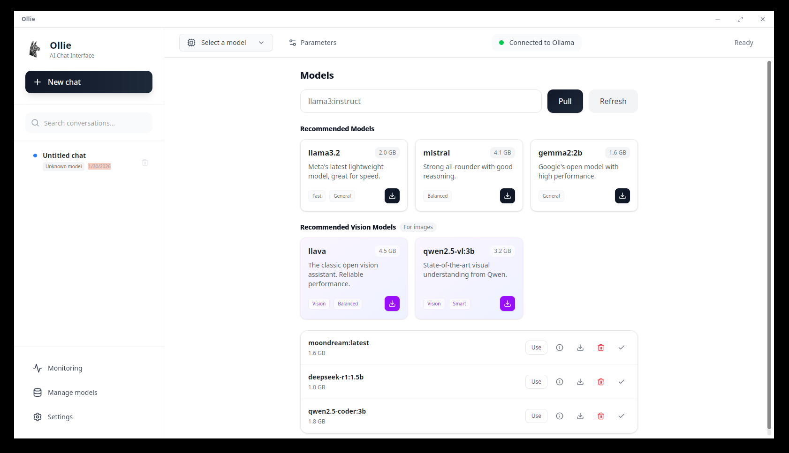
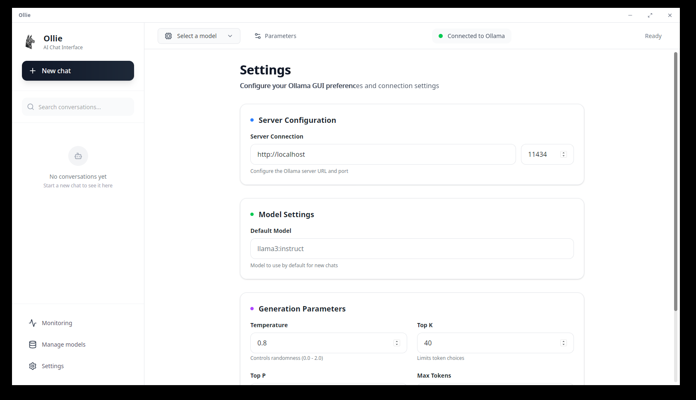
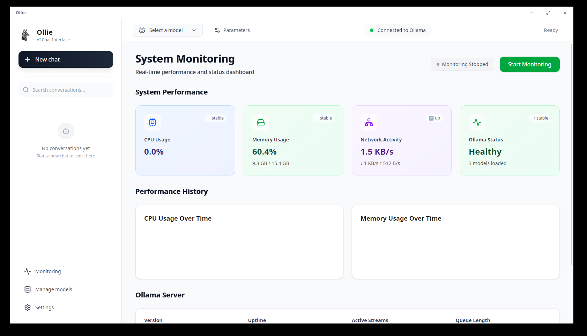

<div align="center">

<table>
  <tr>
    <td align="center" width="150">
      
    </td>
    <td align="center">
      
    </td>
  </tr>
</table>

<h3>Your Friendly Local AI Companion</h3>

[](https://github.com/MedGm/Ollie/releases/latest)
[](https://github.com/MedGm/Ollie/releases)
[](LICENSE)

</div>

Ollie (formerly OllamaGUI) is a Linux desktop app for chatting with local LLMs through [Ollama](https://ollama.com), with optional support for OpenAI, Anthropic, Google Gemini and GroqCloud. Chats and models stay on your machine.



## Install

Local models need [Ollama](https://ollama.com) installed and running.

### Debian / Ubuntu (.deb)

```bash
wget https://github.com/MedGm/Ollie/releases/download/v0.2.16/Ollie_0.2.16_amd64.deb
sudo apt install ./Ollie_0.2.16_amd64.deb
ollie
```

### Fedora / RHEL (.rpm)

```bash
sudo dnf install https://github.com/MedGm/Ollie/releases/download/v0.2.16/Ollie-0.2.16-1.x86_64.rpm
ollie
```

### Any distro (AppImage)

```bash
wget https://github.com/MedGm/Ollie/releases/download/v0.2.16/Ollie_0.2.16_amd64.AppImage
chmod +x Ollie_0.2.16_amd64.AppImage
./Ollie_0.2.16_amd64.AppImage
```

Also listed on [AppImageHub](https://appimage.github.io/Ollie/).

### Arch Linux (AUR)

Unofficial package by [Razgak](https://aur.archlinux.org/account/Razgak) that repackages the AppImage:

```bash
yay -S ollie-appimage-bin
```

## Features

- Chat with Markdown, code highlighting, tables and math
- Pull, delete and inspect Ollama models from the app
- Images for vision models (e.g. LLaVA), plus PDF and text file attachments
- Monitoring dashboard: CPU, memory, running models and VRAM, with unload buttons
- Cloud providers: OpenAI, Anthropic, Google Gemini, GroqCloud; API keys stored in the system keyring
- MCP (Model Context Protocol) tool support
- Per-chat system prompts, message editing and regeneration
- Collapsible reasoning for thinking models
- Live preview of HTML/SVG code blocks
- Automatic context trimming before the model's limit
- Export chats as Markdown
- Light, dark and system themes
- Keyboard shortcuts: `Ctrl+N` new chat, `Ctrl+K` switch model, `Ctrl+/` focus input, `Ctrl+B` toggle sidebar

## Screenshots

| Models | Settings |
|:---:|:---:|
|  |  |

| Monitoring | Vision |
|:---:|:---:|
|  |  |

## Data

- Chats: `~/.config/ollie/app.db` (SQLite)
- Settings: `~/.config/ollie/settings.json`
- Cloud API keys: system keyring (GNOME Keyring / KDE Wallet), or `settings.json` if no keyring is available

## Built with

Tauri v2 (Rust), React 19, TypeScript, Tailwind CSS v4, SQLite.

## Roadmap

- Import chats from ChatGPT/Claude exports; export to JSON or PDF
- Conversation branching
- Side-by-side comparison of multiple models
- Prompt templates
- Chat with a local folder or codebase (RAG)
- Ollama server discovery on the local network
- Create custom Modelfiles from the UI
- Windows and macOS builds

## Stats

<picture>
  <source media="(prefers-color-scheme: dark)" srcset="https://raw.githubusercontent.com/MedGm/Ollie/stats/downloads-dark.svg">
  
</picture>

Exact numbers: [downloads by release](https://github.com/MedGm/Ollie/blob/stats/downloads-by-release.csv) and [weekly totals](https://github.com/MedGm/Ollie/blob/stats/downloads-history.csv). Updated weekly by a GitHub Action.

<a href="https://star-history.com/#MedGm/Ollie&Date">
  <picture>
    <source media="(prefers-color-scheme: dark)" srcset="https://api.star-history.com/svg?repos=MedGm/Ollie&type=Date&theme=dark">
    
  </picture>
</a>

## Contributing

See [CONTRIBUTING.md](CONTRIBUTING.md). Bug reports and pull requests are welcome.

Contributors: [@MedGm](https://github.com/MedGm) (creator and maintainer), [@leoniv](https://github.com/leoniv) (dark theme and UI work).

## License

MIT
